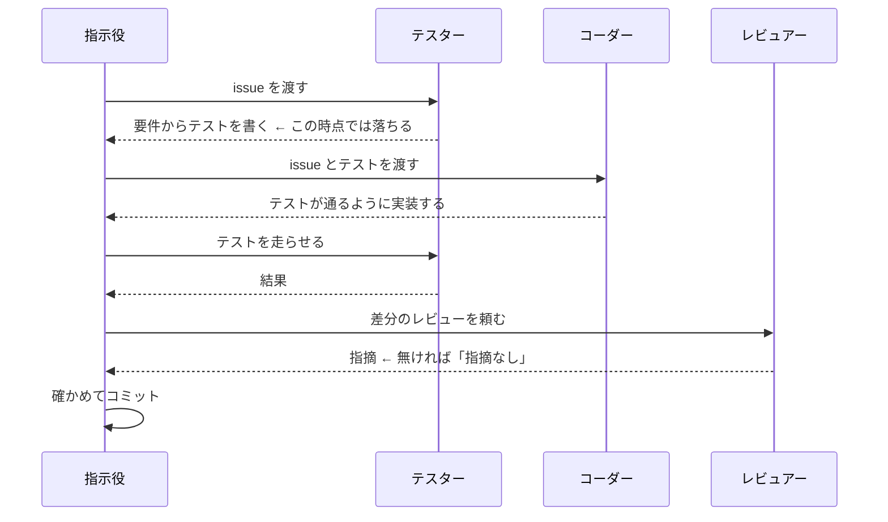

# 家事ポン！

複数人で暮らす家で、誰がいつどの家事をやったかを記録するアプリ。
家事を終えたらパネルを「ポンッ！」と押して、達成感を味わう。

## ドキュメント

| ドキュメント | 内容 |
|---|---|
| [業務要件](docs/01_business-requirements.md) | 何のために、誰が、どう使うか |
| [システム要件](docs/02_system-requirements.md) | どう作り、どこで動かすか |
| [ワイヤーフレーム](docs/03_wireframes.md) | 画面の移り方と、各画面の配置と決まりごと |
| [Penpot](https://design.penpot.app/#/workspace?team-id=8af72ccb-2daf-802c-8008-d2bb5e1d0c9b&file-id=86d07029-2be7-815f-8008-d2bfb7c372d2) | 各画面の見た目。Claude からは MCP（`.mcp.json`）で読み書きする |

## ドキュメントのルール

人にも AI にも読めるように書く。

### 全体

- 業務要件には「使う人から見た振る舞い」を、システム要件には「どう作るか」を書く
- 同じ決まりごとを二か所に書かない。ほかのドキュメントからはリンクで指す
- まだ決めていないことは、勝手に埋めずに「これから決めること」に書いておく
- 図で説明できるところは図にする（mermaid、SVG、表）。ただし決まりごとは必ず文字でも書く
- 必須でない機能は要件に入れず、GitHub の issue にする。業務要件の「後で作るもの」の表に issue 番号を足す

### issue

| 種類 | マイルストーン |
|---|---|
| 最初のリリースで作るもの | `v1` を付ける |
| 後で作るもの | 付けない |

- 実装の仕事はすべて issue にしてから始める（[開発の進め方](#開発の進め方)）

### ワイヤーフレーム

- 画面には `S01`、モーダルには `M01` のような ID を振り、画面一覧の表に並べる
- 画面遷移図、見取り図のファイル名、各画面の見出しで、同じ ID と画面名を使う
- 見取り図は `docs/screens/<ID>-<英語名>.svg` に手書きの SVG で描く
- 各画面には、見取り図と一緒に機能の箇条書きを必ず書く。AI は SVG の絵を見られず、文字を頼りにするため
  - 見取り図と箇条書きが食い違ったら、箇条書きを正とする

## 開発の進め方

Claude Code のサブエージェントで、役割を分けて作る。

| 役割 | 誰が | 定義 |
|---|---|---|
| 指示役 | メインのセッション（Opus） | — |
| テスター | サブエージェント（Sonnet） | [.claude/agents/tester.md](.claude/agents/tester.md) |
| コーダー | サブエージェント（Sonnet） | [.claude/agents/coder.md](.claude/agents/coder.md) |
| レビュアー | サブエージェント（Opus） | [.claude/agents/reviewer.md](.claude/agents/reviewer.md) |

- 1 issue = 1 セッション = 1 worktree。worktree は指示役のセッションごとに作り、サブエージェントの呼び出しでは worktree を分けない
  - テスターとコーダーは同じ worktree を順番に使う。分けると、テスターが書いたテストがコーダーから見えない
  - issue を並べて進めるときは、issue ごとにセッションを分ける
- テスターは実装を、コーダーはテストを書き換えない。レビュアーは何も書き換えない
- レビューの指摘は、実装ならコーダー、テストならテスターに直させ、テストとレビューをやり直す。3 回やり直しても指摘が残るときは、人に聞く
- 要件に書かれていないことは、エージェントが決めずに指示役へ聞く
