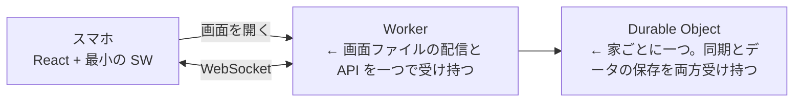
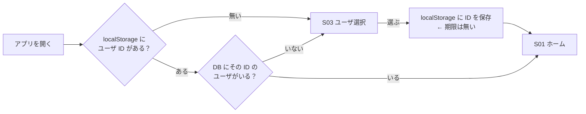
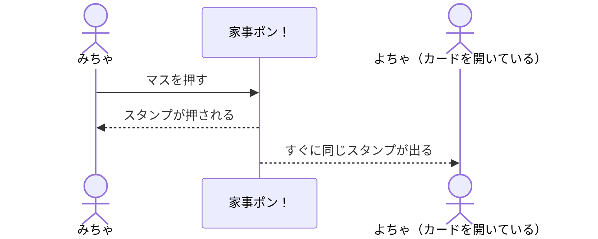

# システム要件

書き途中。

## 使う技術

| 部分               | 使うもの                                                                  |
| ------------------ | ------------------------------------------------------------------------- |
| 言語               | TypeScript（フロントもバックエンドも）                                    |
| フロント           | React の SPA                                                              |
| バックエンド       | Cloudflare Workers（サーバーレス）                                        |
| 同期とデータの保存 | Cloudflare Durable Objects（WebSocket Hibernation API と、付属の SQLite） |
| リポジトリ         | モノレポ                                                                  |
| ソースコードのテスト | Vitest                                                                  |
| 画面のテスト       | Playwright                                                                |

お金をかけずに、無料プランの中で作る。

## デプロイ



- すべて Cloudflare に置く。画面と API が同じドメインになるので、CORS の設定が要らない
- データは Durable Object 付属の SQLite に置く。D1 は使わない

### 無料プランの上限

| 項目                                    | 上限       | 超えたとき                                                       |
| --------------------------------------- | ---------- | ---------------------------------------------------------------- |
| Worker と Durable Object へのリクエスト | 一日 10 万 | その日はエラーになる。数え直しは日本時間の朝 9 時（UTC の 0 時） |
| 画面ファイルの配信                      | 無制限     | 上限を超えても画面は開ける                                       |

## モノレポの分け方

| パッケージ | 中身                               |
| ---------- | ---------------------------------- |
| `web`      | React のフロント                   |
| `api`      | Worker と Durable Object           |
| `shared`   | フロントとバックエンドで共有する型 |

## PWA

- ホーム画面への追加は manifest で行う
- SW は Galaxy の Chrome で「インストールしますか？」の案内を出すためだけに置く。fetch ハンドラは持つが、何もキャッシュしない
  - キャッシュしないので、デプロイ後に古い画面が出続けることがない
  - 送れなかったら終わりなので（[業務要件](01_business-requirements.md)）、電波が無いときに画面だけ開けても役に立たない

## 今のユーザの覚え方



- iPhone の Safari は、7 日開かないサイトの localStorage を消す。ホーム画面から開けば消えないので、ホーム画面からの利用を前提にする

## スタンプの同期



## 日付の区切り

- 日付はサーバ（Cloudflare）の時計を日本時間に直して決める。スマホの時計は使わない。スマホごとに時計がずれていても、全員が同じ日付になる
  - 押した日は、サーバがスタンプを受け取った時刻で決める
- 0 時になったら、Durable Object のアラームで、カードを開いている全員に WebSocket で知らせる。受け取ったスマホは、カードをまっさらにして、日付が変わったことをスナックバーで知らせる

```text
23:59  カードにその日のスタンプが並んでいる
00:00  Durable Object のアラームが鳴る → 全員に知らせる
       → カードがまっさらになり、スナックバーが出る ← 開き直さなくてよい
```
