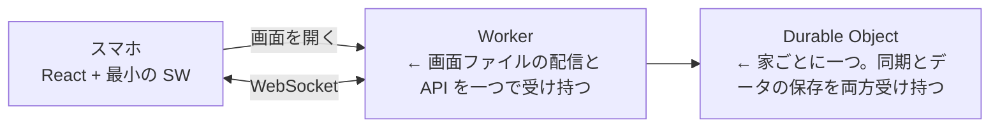
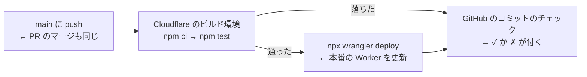
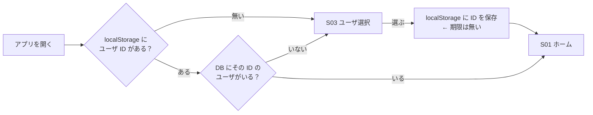
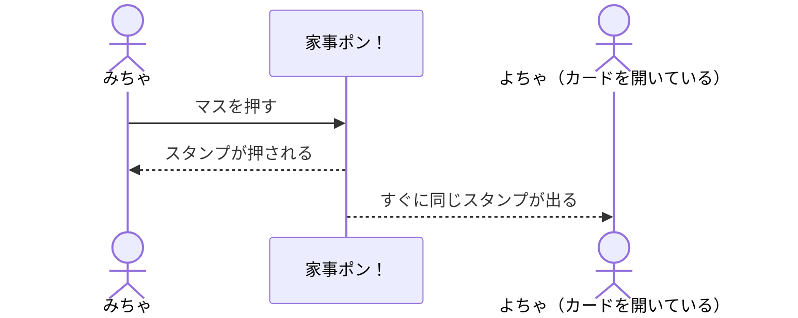

# システム要件

書き途中。

## 使う技術

| 部分                 | 使うもの                                                                  |
| -------------------- | ------------------------------------------------------------------------- |
| 言語                 | TypeScript（フロントもバックエンドも）                                    |
| フロント             | React の SPA                                                              |
| バックエンド         | Cloudflare Workers（サーバーレス）                                        |
| 同期とデータの保存   | Cloudflare Durable Objects（WebSocket Hibernation API と、付属の SQLite） |
| リポジトリ           | モノレポ                                                                  |
| ソースコードのテスト | Vitest                                                                    |
| 画面のテスト         | Playwright                                                                |

お金をかけずに、無料プランの中で作る。

## デプロイ



- すべて Cloudflare に置く。画面と API が同じドメインになるので、CORS の設定が要らない
- データは Durable Object 付属の SQLite に置く。D1 は使わない

### 自動デプロイ

Cloudflare の Workers Builds で、main に入ったものを本番に出す。GitHub に Cloudflare の API トークンを置かずに済むので、GitHub Actions は使わない。



- テストが落ちたらデプロイしない。`npm test` は中で画面のビルドもする
- 失敗には、main のコミットに付く ✗ で気づく。メールなどの通知は使わない
- main 以外のブランチと PR はビルドしない。Worker のプレビューは使わない
  - プレビューのビルドは中で必ず `npx wrangler preview` を呼ぶ決まりで、テストだけ走らせることはできない

ダッシュボードでの設定（Workers & Pages → `kaji-pon` → 設定 → ビルド → 「プロダクション」）：

| 項目                       | 値                                                         |
| -------------------------- | ---------------------------------------------------------- |
| Git リポジトリ             | `nagiurrrr/kaji-pon`                                       |
| プロダクションブランチ     | `main`                                                     |
| ビルドコマンド             | `npm test`                                                 |
| デプロイコマンド           | `npx wrangler deploy --config packages/api/wrangler.jsonc` |
| ルートディレクトリ         | `/`（リポジトリの一番上。npm workspaces のため）           |
| プレビューブランチのビルド | 切る（「プレビューのベース」の札にある）                   |

### 無料プランの上限

| 項目                                    | 上限                     | 超えたとき                                                       |
| --------------------------------------- | ------------------------ | ---------------------------------------------------------------- |
| Worker と Durable Object へのリクエスト | 一日 10 万               | その日はエラーになる。数え直しは日本時間の朝 9 時（UTC の 0 時） |
| 画面ファイルの配信                      | 無制限                   | 上限を超えても画面は開ける                                       |
| Workers Builds のビルド                 | 月 3,000 分、同時に 1 つ | 超えた月はビルドされない。手で `npm run deploy` すれば出せる     |

## モノレポの分け方

| パッケージ | 中身                               |
| ---------- | ---------------------------------- |
| `web`      | React のフロント                   |
| `api`      | Worker と Durable Object           |
| `shared`   | フロントとバックエンドで共有する型 |

### パッケージの中の分け方

`web` と `api` の中は、技術の種類（components、hooks など）ではなく、機能ごとにフォルダを分ける（フィーチャーベースドデザイン）。

```text
web/src/
  main.tsx         ← 入口。機能の処理は持たない
  features/
    <機能名>/      ← その機能の画面・部品・処理・テストをまとめて置く
      index.ts     ← ほかから使ってよいものだけを出す
      *.test.ts    ← その機能のテスト
  common/          ← 二つ以上の機能で使うもの
```

- 入口（web の `main.tsx`、api の `index.ts`）は `src/` の直下に一つだけ置く。`features/*/index.ts` と `common/` だけを import し、振り分けだけをする
- 機能のフォルダの中身は、その機能の `index.ts` を通してだけ使う。中のファイルを直接 import しない
- 機能から別の機能を import しない。二つ以上の機能で使うものは `common/` に、フロントとバックエンドで使う型は `shared` に移す
- `api` も同じ形で分ける
  - Durable Object の `House` は全部の機能が使うので `common/house.ts` に置き、入口から export する（wrangler が入口から探すため）
  - 疎通確認の `/api/health` は `features/health/` に置く
- ソースコードのテストは、その機能のフォルダ（または `common/`）に並べて置く。画面のテストはリポジトリ直下の `e2e/` に置く

これから決めること：

- 機能の一覧と、それぞれの名前

## PWA

- ホーム画面への追加は manifest で行う
- SW は Galaxy の Chrome で「インストールしますか？」の案内を出すためだけに置く。fetch ハンドラは持つが、何もキャッシュしない
  - キャッシュしないので、デプロイ後に古い画面が出続けることがない
  - 送れなかったら終わりなので（[業務要件](01_business-requirements.md)）、電波が無いときに画面だけ開けても役に立たない
- iPhone の Safari では案内が出ない。追加のしかたは家の人に直接伝え、アプリの中には案内を出さない

## 今のユーザの覚え方



- iPhone の Safari は、7 日開かないサイトの localStorage を消す。ホーム画面から開けば消えないので、ホーム画面からの利用を前提にする

## スタンプの同期



## 日付の区切り

- 日付はサーバ（Cloudflare）の時計を日本時間に直して決める。スマホの時計は使わない。スマホごとに時計がずれていても、全員が同じ日付になる
  - 押した日は、サーバがスタンプを受け取った時刻で決める
- 0 時になったら、Durable Object のアラームで、カードを開いている全員に WebSocket で知らせる。受け取ったスマホは、カードをまっさらにして、日付が変わったことをスナックバーで知らせる

```text
23:59  カードにその日のスタンプが並んでいる
00:00  Durable Object のアラームが鳴る → 全員に知らせる
       → カードがまっさらになり、スナックバーが出る ← 開き直さなくてよい
```
