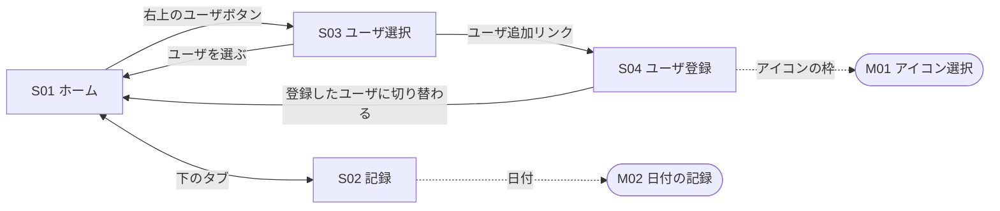
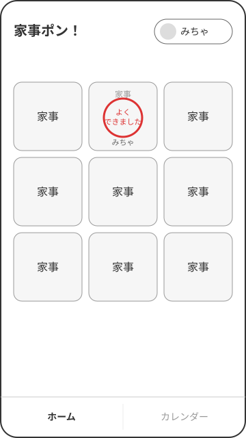
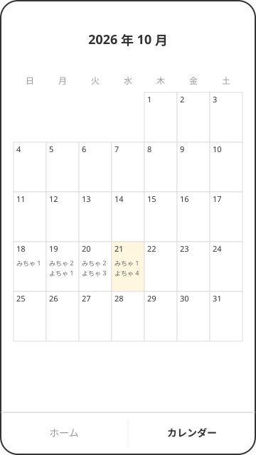
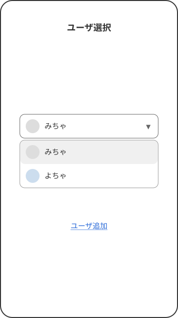
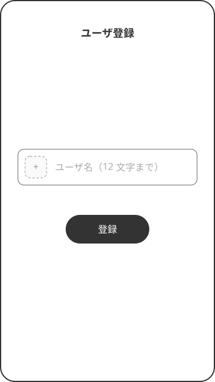
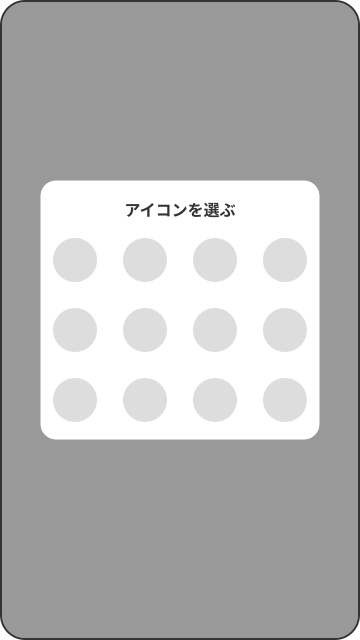
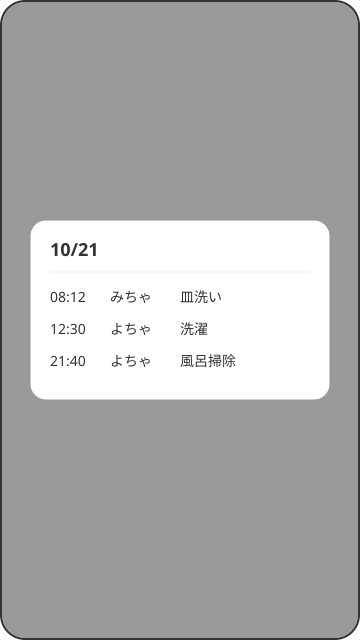

# ワイヤーフレーム

画面の見た目は [Penpot](https://design.penpot.app/#/workspace?team-id=8af72ccb-2daf-802c-8008-d2bb5e1d0c9b&file-id=86d07029-2be7-815f-8008-d2bfb7c372d2) で作る。ここには画面の ID、移り方、配置のラフ、決まりごとを書く。見た目は Penpot を、決まりごとはこのファイルを正とする。

## 画面一覧

| ID | 画面名 | 種類 |
|---|---|---|
| S01 | ホーム | 画面 |
| S02 | 記録 | 画面 |
| S03 | ユーザ選択 | 画面 |
| S04 | ユーザ登録 | 画面 |
| M01 | アイコン選択 | モーダル（S04 の上に開く） |
| M02 | 日付の記録 | モーダル（S02 の上に開く） |

## 画面遷移

四角は画面、角の丸い枠はモーダル。

## どの画面にも出るもの

### スナックバー

- 画面の下に一行のメッセージを出し、しばらくすると自分で消える。どの画面でも同じものを使う
- 使う場面

| 場面 | 伝えること |
|---|---|
| 日本時間の 0 時をまたいだ | 日付が変わって、カードがまっさらになった |
| スタンプを送れなかった | 送れなかったこと |

## 各画面の定義

S01 ホーム

[Penpot で開く](https://design.penpot.app/#/workspace?team-id=8af72ccb-2daf-802c-8008-d2bb5e1d0c9b&file-id=86d07029-2be7-815f-8008-d2bfb7c372d2&page-id=86d07029-2be7-815f-8008-d2bfb7c372d3&board-id=e12717a4-f7ca-806d-8008-d2c095f0a3a3)

- 右上：今のユーザのアイコンと名前のボタン。押すと S03 ユーザ選択へ
- 中央：3×3 の 9 マス。押したマスには「よくできました」のスタンプと、押した人の名前が出る
- 下：S01 ホームと S02 記録を切り替えるタブ

S02 記録

[Penpot で開く](https://design.penpot.app/#/workspace?team-id=8af72ccb-2daf-802c-8008-d2bb5e1d0c9b&file-id=86d07029-2be7-815f-8008-d2bfb7c372d2&page-id=86d07029-2be7-815f-8008-d2bfb7c372d3&board-id=99478ffe-5362-8002-8008-d2c3fb9e733c)

- これまでの記録をカレンダーの形で見せる。下のタブでの表示名は「カレンダー」
- 日付のマスは狭いので、その日に誰が何回スタンプを押したかを、名前と数だけで出す
- 日付を押すと M02 日付の記録が開く

S03 ユーザ選択

[Penpot で開く](https://design.penpot.app/#/workspace?team-id=8af72ccb-2daf-802c-8008-d2bb5e1d0c9b&file-id=86d07029-2be7-815f-8008-d2bfb7c372d2&page-id=86d07029-2be7-815f-8008-d2bfb7c372d3&board-id=99478ffe-5362-8002-8008-d2c4013812b1)

- 中央：プルダウン。開くとアイコンと名前のリストが出る（図は開いたところ）
  - 一軒あたりの人数は多くないので、プルダウンで足りる
- 「ユーザ追加」リンクを押すと S04 ユーザ登録へ

S04 ユーザ登録

[Penpot で開く](https://design.penpot.app/#/workspace?team-id=8af72ccb-2daf-802c-8008-d2bb5e1d0c9b&file-id=86d07029-2be7-815f-8008-d2bfb7c372d2&page-id=86d07029-2be7-815f-8008-d2bfb7c372d3&board-id=99478ffe-5362-8002-8008-d2c4028d5b4b)

- 少し大きめのテキストフィールドにユーザ名を入れる。ユーザ名は最大 12 文字
- テキストフィールドの左端にアイコンの枠があり、押すと M01 アイコン選択が開く
- 「登録」を押すと、登録したユーザに切り替わって S01 ホームへ

M01 アイコン選択

[Penpot で開く](https://design.penpot.app/#/workspace?team-id=8af72ccb-2daf-802c-8008-d2bb5e1d0c9b&file-id=86d07029-2be7-815f-8008-d2bfb7c372d2&page-id=86d07029-2be7-815f-8008-d2bfb7c372d3&board-id=99478ffe-5362-8002-8008-d2c4038c0cd8)

- 最初から用意した 12 種類ほどのアイコンから選ぶ
  - アイコンの絵（SVG）はフロントアプリが持ち、データにはどのアイコンかを示す ID だけを残す

M02 日付の記録

[Penpot で開く](https://design.penpot.app/#/workspace?team-id=8af72ccb-2daf-802c-8008-d2bb5e1d0c9b&file-id=86d07029-2be7-815f-8008-d2bfb7c372d2&page-id=86d07029-2be7-815f-8008-d2bfb7c372d3&board-id=99478ffe-5362-8002-8008-d2c4054610e5)

- その日に誰が何時に何の家事をやったかを、時刻の順に並べる

